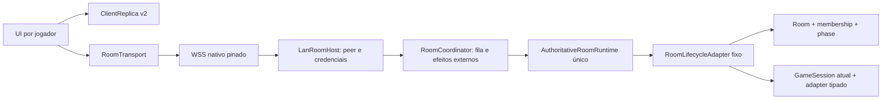

# Galerows — PL-00: design técnico do lobby persistente

**Status:** proposta para revisão, 11/10/2026. **Escopo desta entrega:** somente design. Nenhum contrato abaixo está implementado. Fonte normativa de produto: [`docs/multiplayer-persistent-lobby-spec.md`](../../multiplayer-persistent-lobby-spec.md); sequência de gates: [`2026-10-11-persistent-lobby-roadmap.md`](2026-10-11-persistent-lobby-roadmap.md). Branch auditada: `feat/multiplayer-lan-task1-wss`, HEAD `fbfb342e37185470e82d1d021d05ddbb7a8e9c95`, com working tree e arquivos não rastreados preexistentes preservados.

## 1. Decisão

**Escolher B: um único `AuthoritativeRoomRuntime` persistente por Room, com um `RoomLifecycleAdapter` fixo e delegação tipada para no máximo uma GameSession ativa.** O adapter do runtime **nunca é trocado**. Um `RoomCoordinator` fino, acima do runtime e abaixo de `LanRoomHost`, gerencia operações com efeito externo (ingresso, presença, `LEAVE_ROOM`, credenciais, encerramento) e serializa todas as transições. O estado canônico do wrapper contém o lifecycle da sala, o rascunho de configuração e, quando existe, a GameSession. O redutor de lifecycle e os adapters de jogo são módulos distintos; comandos de sala não são enviados ao adapter de jogo.

Isso mantém **uma** fonte de membership, `roomRevision`, deduplicação, barreiras, projeção privada e resync. `roomId`, `hostPlayerId`, `playerId`, endpoint WSS e identidade TLS permanecem os mesmos ao trocar de partida. A nova `gameSessionId` é gerada pelo host em cada `START_GAME`. A escolha não depende de mutar uma referência de `GameAdapter` em execução.

| Critério | A — coordenador com runtimes por partida e snapshot envelope | B — runtime persistente e adapter delegante fixo |
| --- | --- | --- |
| Simplicidade de autoridade | Exige conciliar membership e resultados entre Room e vários runtimes | Reutiliza uma autoridade; o wrapper separa lifecycle do redutor de jogo |
| Ordem de revisões e gaps | Precisa traduzir revisões de cada filho para uma sequência global | Usa a revisão existente como `roomRevision` única |
| Atomicidade da troca | Requer transação entre encerrar filho, criar outro e publicar envelope | Uma transição canônica troca sessão e projeção no mesmo revision |
| Segredo/resync | Envelope precisa decidir qual filho projeta cada destinatário e limpar estado anterior | Projeção do wrapper retorna `null` fora da sessão ou para espectador; replica substitui o valor |
| Deduplicação | Mapas por filho permitem reexecutar comandos de sala ou de partidas antigas | Namespace de sessão no comando e deduplicação na autoridade persistente |
| LAN/backward compatibility | `LanRoomHost` hoje espera um runtime concreto; adaptação ampla | Mantém um runtime, transporte e pinning; evolui tipos/wire de modo versionado |
| Testabilidade | Mais combinações de revisão e falha entre autoridades | Redutor de lifecycle, adapter sintético e runtime podem ser testados sem rede |

**Custo de B:** o wrapper precisa ser uma união discriminada e não um `any` que encaminha comandos arbitrários. O runtime atual ainda precisa de extensões controladas para host local explícito, presence revisionada, saída autenticada e limpeza atômica de barreiras. Essas mudanças pertencem aos gates posteriores; PL-00 não as executa.

## 2. Auditoria do código existente

| Componente | Comportamento verificado | Lacuna para lobby persistente |
| --- | --- | --- |
| `runtime.ts` | `GameAdapter` fixo; membership por `playerId` e `connectionId`; `join`, `leave`, `disconnect`, `reassociate`; uma revisão; dedup por `commandId`; projeção/marker privado por destinatário; resync autorizado | Não tem host role, phase, seleção, ready, GameSession nem presença revisionada. `disconnect` não avança revisão. Dedup cresce pela vida da sala. Barriers ficam fora do estado do adapter e não têm reset por partida. `processCommand` requer preflight de todas as projeções antes de commit para garantia transacional em falha de projeção/tamanho. |
| `gameAdapter.ts` | Redutor imutável, parse, projeções públicas/privadas, efeitos de barreira | Representa um jogo fixo. Precisa de wrapper discriminado e efeito de limpar/escopar barreiras na troca. |
| `protocol.ts` | `Command` v1 usa `roomId/playerId/commandId/type/payload`; `Event` e `Snapshot` têm `revision` único; `CommandResult` não avança replica | Não identifica GameSession nem versão de modelo do lobby; não transporta presença/phase/host; parser aceita tipos genéricos. |
| `clientReplica.ts` | Aceita só próximo evento, detecta gap, substitui snapshot e `privateState`, ignora resultado para sequenciamento | Precisa entender envelope `gameSessionId` e `null` obrigatório ao sair/trocar partida; impedir UI de usar secreto antigo antes de aplicar transição. |
| `lanRoomHost.ts` | Mantém binding peer→conn→player, ingresso com ACK, credencial individual, retomada e `roomClosed`; serializa parte dos envios | Acopla ao runtime concreto. `stop()` é fechamento de Room; não há `LEAVE_ROOM` nem revogação por saída. Admissão e comandos de lifecycle precisam entrar na mesma fila de transição. |
| `lanRoomSession.ts` / `lanRoomTransport.ts` | TLS pinado + código presencial + confirmação; Keystore para resume; replica aplica evento/snapshot e pede resync em gap; `room_closed` difere de `connection_lost` | A UI `Sair` só desconecta; não remove membership. Resume deve restaurar lobby/partida com mesmo playerId e snapshot v2. |
| `lanWire.ts` / nativo | Frames v1 versionados, limite lógico UTF-8 de 16 KiB, inclusive fragmentos no nativo | Adicionar comandos/envelopes v2 sem permitir interpretação parcial por cliente v1; medir pior caso antes de ampliar dados de sala. |
| `LanRoomScreen.tsx` | Sonda experimental Android, adapter contador, QR/manual, código presencial, reconexão limitada e feature flag | Não é lobby, não navega por fase autoritativa e `Sair` mantém credencial/membership. Preservar QR da Adedonha como formato independente. |
| `games.registry.ts` | Catálogo solo com `minPlayers/maxPlayers/isAvailableOffline` | Nenhum campo comprova suporte multiaparelho. Criar catálogo multiplayer explícito; não inferir compatibilidade de `isAvailableOffline`. |
| Impostor da Palavra | Sessão solo guarda papéis, fila, cartas e perguntas em um objeto; `getParticipantBriefing` seleciona informação por participante; setup exige 3–12 | Não reutilizar store solo como autoridade LAN. `createImpostorQueue` sorteia com reposição, divergindo da regra do `ROADMAP.md`; resolver no gate do jogo, sem mudar agora. |

Evidência física histórica da Task 6: [`docs/lan-task6-physical-gate-evidence.md`](../../lan-task6-physical-gate-evidence.md) aprova o APK Android **experimental** em dois Samsung no hotspot sem WAN; não aprova Release nem prova isolamento com três aparelhos.

## 3. Fronteiras e contratos propostos



**Room canônica:** `{roomId, hostPlayerId, roomName?, phase, memberMetadata, selectedGameId?, validatedConfig?, currentGameSession?, lastPublicResult?}`. `roomRevision` pertence ao runtime e é exposta na projeção da Room; não há uma segunda cópia mutável no estado do wrapper. O mapa de membership/conexão do runtime permanece a fonte única de quem pertence à sala; `memberMetadata[playerId]` guarda somente apelido, role, ready e participação. A projeção `members[]` combina membership/presence do runtime com esses metadados. Hooks transacionais de `join`, `leave`, `disconnect` e `reassociate` atualizam metadados/projeção na mesma revisão; não se mantém uma segunda lista independente de membros. `displayName` é visual e sanitizado, nunca autorização. `presence=disconnected` mantém membership/vaga/credencial; `participation=waiting` vale para ingresso durante partida. O host local é criado com `playerId` reservado explicitamente pela API local do runtime, sem depender de ser o primeiro `join()` nem confiar num `playerId` enviado pelo peer. Limite inicial da Room: 12 memberships, incluindo host; o nativo ainda impõe seu teto de peers. Um jogo pode impor limite menor para participantes da GameSession.

**GameSession:** `{gameSessionId, gameId, status, frozenParticipantIds, validatedConfig, canonicalGameState, publicResult?}`. No máximo uma `running`. A seleção/configuração existe como *draft* de Room antes de `START_GAME`; a GameSession nasce atomicamente em `START_GAME`. Seu `gameSessionId` jamais é reutilizado, inclusive em “Jogar novamente”. Em `RETURN_TO_LOBBY`, descartar o estado canônico e privado; manter só resultado público mínimo e limitado em memória. A lista de participantes é congelada no início. Ingresso durante `playing` ou `results` cria membro `waiting`, com `privateState=null`, sem alterar sorteio ou lista congelada.

**Catálogo multiplayer separado:** `MultiplayerGameDefinition` tipado por `gameId` declara `minPlayers`, `maxPlayers`, validação de config, criação de sessão, parse/aplicação de comando, projeção pública e projeção privada por `playerId`. Só `gameId` implementado e aprovado aparece na seleção. Os limites do catálogo solo são referência de UX, não contrato multiplayer. PL-02 usa dois adapters sintéticos; Impostor é o primeiro consumidor real futuro, Adedonha o segundo. Clock e RNG relevantes só vêm do host e entram no contexto testável.

**Comando v2:** envelope discriminado `scope: 'room' | 'game'`, `roomId`, `playerId`, `commandId`, `clientSeq`, `type` e `payload`; todo comando `scope='game'` exige `gameSessionId`. O `commandId` e `clientSeq` ficam estáveis no retry. O host valida o binding do socket *antes* de role, fase ou adapter. A deduplicação inclui `playerId`, scope, `gameSessionId`, type e payload; reuse conflitante retorna `command_conflict`. Um `gameSessionId` anterior retorna `stale_game_session`, sem chamar o adapter atual. Um único comando em voo por jogador e sequência monotônica por jogador permitem cache limitado do último resultado: sequência antiga é rejeitada, retry da última retorna o mesmo resultado/revisão, sem reexecutar. Todo comando autenticado e estruturalmente válido consome sua sequência, inclusive quando a regra de fase/role rejeita; frame inválido ou peer não autenticado não a consome. `CommandResult` informa o próximo `clientSeq` esperado, e o snapshot privado do próprio jogador o restaura no resync/restart. `protocol.ts`, o parser, `CommandErrorCode` e o contrato de resultado evoluem juntos para os novos erros; não tentar escondê-los no conjunto restrito de erros de `GameAdapter` v1. PL-01 pode manter o wire v1 para `LEAVE_ROOM`; PL-02 introduz protocolo de sala v2 e recusa cliente v1 em sala v2 antes de mutar estado. Nenhum downgrade silencioso. Os modos solo não usam esse wire e permanecem intactos.

**Lifecycle actions:** `SELECT_GAME`, `CONFIGURE_GAME`, `READY`, `START_GAME`, `END_GAME`, `RETURN_TO_LOBBY`, `LEAVE_ROOM` e, após política de UX, `REMOVE_MEMBER` do host. `CLOSE_ROOM` continua operação terminal separada em `LanRoomHost.stop()`. `LEAVE_ROOM` não entra no `GameAdapter`: o coordinator autentica peer, revoga credencial e remove membership. `READY` de guest é somente para si; o host também marca sua própria prontidão. `END_GAME` inclui resultado `completed` ou `aborted` sanitizado. `START_GAME` valida novamente configuração, fase, host conectado, ready, participantes conectados e contagem `min..max`; apenas membros conectados e prontos entram na lista congelada. Demais membros aguardam a próxima partida. O host só sai definitivamente encerrando a Room.

**Projeção v2:** manter `revision` no wire com semântica de `roomRevision` monotônica; não introduzir `gameRevision` como segundo cursor de transporte. Snapshot/evento contém `roomState` público, `gamePublicState: null | {gameSessionId, gameId, data}` e `privateState: null | {gameSessionId, data}`. Resultados de comando não avançam a replica. Toda mudança visível de membership, presence, ready, phase, sessão ou estado de jogo incrementa exatamente uma revisão; no-op/dedup não incrementa. Cada revisão envia a nova projeção a todo destinatário cujo estado público ou privado mudou e `marker` somente aos demais, preservando sequência. `SELECT_GAME` e `RETURN_TO_LOBBY` enviam `privateState=null` quando um segredo deixa de ser autorizado. A replica substitui o valor anterior antes de a UI navegar; não guarda segredo antigo em stores, histórico de rota ou logs. Resync retorna snapshot v2 apenas da conexão vinculada ao jogador; espectador recebe privado nulo. Snapshot antigo nunca substitui revisão nova.

**Barreiras e tamanho:** efeitos de barreira atuais pertencem ao runtime, não ao adapter. Em v2, cada barreira deve ser escopada por `gameSessionId` e limpa na mesma transição que encerra a sessão; lobby não projeta barreiras de jogo anterior. Antes do commit, gerar e codificar todas as projeções necessárias; se alguma exceder 16 KiB UTF-8 ou lançar, rejeitar a transição sem alterar estado/revisão/dedup. Testar 12 membros, nomes máximos, config, resultado e dados UTF-8 reais. Não elevar limite nem confiar em fragmentação para contorná-lo; o adapter deve produzir projeções menores.

## 4. Estados, transições e falhas

| Estado atual | Ação/evento | Autorização e guarda | Novo estado / efeito | Rejeição ou falha |
| --- | --- | --- | --- | --- |
| `lobby` | `SELECT_GAME(gameId)` | Host vinculado; gameId no catálogo multiplayer | `configuring`; seleciona jogo, zera ready; +1 revisão | `unauthorized`, `unsupported_game`, `invalid_phase` |
| `configuring` | `CONFIGURE_GAME(config)` | Host; schema e tamanho válidos | `configuring`; config validada, zera ready; +1 se mudou | `invalid_config`, `unauthorized`; sem estado parcial |
| `lobby`/`configuring` | `READY(value)` | Próprio membro conectado; não `waiting` | Atualiza ready; +1 se mudou | `unauthorized`, `invalid_phase` |
| `configuring` | `START_GAME` | Host; config atual; grupo conectado/pronto dentro de min/max | Cria nova `gameSessionId`, congela inscritos, status `running`, phase `playing`; +1 | `not_ready`, `invalid_player_count`, `invalid_phase`; nenhum sorteio em retry |
| `playing` | comando de jogo | Participante inscrito, conn atual, `gameSessionId` atual | Adapter ativo aplica; +1 se mudou | `stale_game_session`, `not_participant`, `invalid_phase` |
| `playing` | `END_GAME` | Host ou conclusão validada pelo adapter | `results`, status `completed/aborted`, resultado público mínimo; +1 | Guest forjado rejeitado; falha de projeção aborta transição |
| `results` | `RETURN_TO_LOBBY` | Host | `lobby`; remove sessão/segredos/barreiras, ready=false; mantém room/player IDs; +1 | Guest forjado ou fase errada rejeitado |
| Qualquer fase aberta | novo ingresso confirmado | Capacidade válida, TLS pinado, código presencial, slot livre | Mesmo Room; durante jogo entra `waiting`, privado nulo; +1 | Convite vencido/usado, sala cheia, admissão sem ACK: compensar; nunca criar inscrito retroativo |
| Qualquer fase aberta | perda de socket | Binding atual | `presence=disconnected`, membership e credencial mantidos; +1 e aviso | Peer antigo/duplicata não muda revisão |
| Qualquer fase aberta | resume autenticado | Credencial atual, room/player válidos | Nova conn, peer antigo desautorizado, `presence=connected`; +1 e snapshot privado atual | Credencial ausente/expirada/forjada não altera Room |
| Qualquer fase aberta | `LEAVE_ROOM` | Próprio peer autenticado; host usa `CLOSE_ROOM` | Revoga credenciais, remove membro e vaga; +1; resultado idempotente | Falha nativa antes do commit mantém membro bloqueado para retry; ACK perdido não desfaz saída |
| Qualquer fase aberta | `REMOVE_MEMBER(playerId)` | Só host, alvo guest, confirmação UI | Mesmo efeito terminal de saída, com motivo público | Host/guest não removem outro por falsificação |
| Qualquer fase aberta | `CLOSE_ROOM` | Host local | `closed`; `roomClosed`, revoga tudo, para nativo | Queda sem frame continua `connection_lost`, não afirma fechamento |

Não aceitar `SELECT_GAME`/`START_GAME` durante `playing` ou `results`. “Jogar novamente” é `RETURN_TO_LOBBY → SELECT_GAME` (se necessário) → `CONFIGURE_GAME` (se necessário) → ready → `START_GAME`; pode manter seleção/config pública validada para facilitar replay, mas revalida no novo START. “Escolher outro jogo” primeiro retorna ao lobby. Esses passos geram novas revisões e nova GameSession, sem novo QR ou socket.

### Saída e falhas de resposta

O coordinator serializa `LEAVE_ROOM` com commands/join/resume. Após validar o binding, bloqueia novos comandos do membro, revoga `current` e `pending` no autenticador nativo, remove membership e publica a revisão; só então envia `LeaveConfirmed {commandId, roomRevision}` e fecha o peer. Uma falha de revogação de resultado incerto mantém o membro em estado interno `leaving` sem permitir comandos ou resume até a revogação ser concluída/reconciliada; nunca informa sucesso prematuro. Guardar tombstone de saída `(roomId, playerId, commandId, resultado)` com prazo limitado para responder retries enquanto o peer ainda estiver autenticado sem segunda remoção; após revogação e fechamento do peer, retries sem autenticação são rejeitados. Se o ACK se perder e o socket morrer, a credencial já revogada não recupera o membro; a UI apresenta **“saída não confirmada neste aparelho”**, limpa o cofre somente após confirmação ou rejeição terminal verificável e oferece novo ingresso por convite. Não há garantia de entrega exatamente uma vez do ACK; há efeito de saída no máximo uma vez. PL-01 deve provar essa ambiguidade e documentar a política final antes da UI de PL-03.

Presence é distinta de membership. Desconexão não libera vaga nem revoga token; retorno autenticado preserva `playerId`, ready e participação, mas `START_GAME` só considera conectados. Um participante inscrito que caia durante jogo permanece inscrito e a política do adapter determina pausa/timeout/aborto, sem sorteio novo. Host pode remover guest inativo com confirmação; TTL de inatividade deve ser parâmetro explícito do Room e nunca inferido do prazo de convite. A política inicial recomendada é **sem expulsão automática durante uma partida**; fora dela, UI avisa antes de remoção pelo host. Host local não é removível enquanto Room aberta.

## 5. Revisões, ordem e segurança

```mermaid
sequenceDiagram
  participant G as Guest
  participant L as LanRoomHost
  participant C as RoomCoordinator
  participant R as Runtime único
  G->>L: Command v2 (commandId, clientSeq, gameSessionId?)
  L->>C: peer/connection autenticados
  C->>R: transição serializada
  R->>R: valida role, phase, sessão; preflight de projeções
  R-->>C: resultado + revisão N + entregas por jogador
  C-->>L: fila de entregas em ordem N
  L-->>G: CommandResult N (não avança replica)
  L-->>G: Event N ou marker
  G->>G: aplica N; limpa privado antigo quando null
  opt gap/reconexão
    G->>L: ResyncRequest autenticado
    L-->>G: Snapshot da revisão atual, privado só de G
  end
```

O coordinator mantém fila única para ingresso confirmado, presença, comandos, saída, resume e encerramento. A decisão e pré-projeção de uma revisão ocorrem antes da próxima; entregas por peer são serializadas e limitadas como hoje. `CommandResult` pode chegar antes de `Event`, sem avançar o cursor. Um evento atrasado de GameSession A com revisão menor que a troca para B é stale; um evento A futuro com revisão válida não deve existir porque o host só projeta a sessão canônica atual. Cliente em gap para incremental e pede snapshot; não aplica evento de B sobre segredo de A. O servidor nunca roteia por `playerId` alegado no frame, e peer/conn antigo perde autorização após resume.

`LanIngressHost`, WSS, fingerprint, convite de 120 s e uso único, código presencial, admissão em duas fases e cofre Android seguem como fronteira de entrada. Descoberta futura não fornece capacidade nem autorização. `LEAVE_ROOM` e troca de jogo não chamam `LanRoomHost.stop()`. O encerramento da Room é o único evento que envia `roomClosed` e revoga todas as credenciais.

## 6. Riscos e decisões de rollout

| Risco | Tratamento proposto / gate |
| --- | --- |
| Processo do host morto, Activity destruída ou host muito tempo em background | Sem migração/failover na V1. UI guest mostra perda e tentativas limitadas; só `roomClosed` autenticado é fechamento definitivo. Host em background não promete progressão de jogo; testar pause/retorno e morte do processo em PL-02/PL-05. |
| Certificado TLS efêmero válido 24 h; credencial de retomada vale 2 h | Sala longa hoje pode perder ingresso/reconnect mesmo com host vivo. PL-02 deve renovar credencial ativa antes de 2 h por canal pinado. Até existir rekey TLS com continuidade autenticada pelo canal antigo, impor prazo visível de sala inferior à validade do certificado e fechamento explícito antes da expiração; **não** prometer duração ilimitada no Release. A extensão de sala além de 24 h requer decisão/gate próprio. |
| Replay, comando da sessão anterior, peer antigo e ACK perdido | `gameSessionId` + sequência/comando estável, binding atual, tombstone de leave e testes de duplicata/forja. Não reutilizar IDs de sessão. |
| Projeção antiga ou barreira antiga após troca | Limpar segredo e barreiras na mesma revisão; `privateState=null`; UI espera aplicação da revisão antes de navegar. Snapshot de resume sempre da sessão atual. |
| Dedup v1 sem limite para Room longa | Protocolo v2 serial por jogador com `clientSeq` e cache limitado; nunca evictar silenciosamente um ID que ainda poderia mutar a sessão. Medir memória em teste de duração. |
| Frame v2 maior que 16 KiB | Pré-projetar para todos e testar UTF-8 no pior caso; rejeitar transição antes do commit se exceder. Sem ampliar limite nesta fase. |
| Convidado entra no meio do jogo ou outro jogo tem max menor | Membership entra como `waiting`; participante ativo congelado. START seguinte revalida min/max/readiness. |
| Divergência das regras de Impostor | Resolver fila/sorteio em gate de jogo futuro. PL-02 usa adapters sintéticos, nunca store solo. |
| Apenas dois aparelhos disponíveis | Cobrir isolamento com três clientes simulados; não rotular como prova física de três aparelhos. PL-05 registra limite até existir terceiro aparelho real. |

**Rollout:** PL-01 implementa e valida saída real sobre o modelo LAN atual. PL-02 introduz runtime/lifecycle v2 sob flag, dois adapters sintéticos e prova `A → results → lobby → B` na mesma conexão. PL-03 adiciona UI autoritativa e navegação. PL-04 é spike separado de descoberta com fallback QR/manual. PL-05 revalida Release físico/segurança; PL-06 integra Impostor, depois Adedonha. Cada gate conserva o caminho solo e pode ser revertido desativando a flag sem reset/clean de dados ou alteração do histórico LAN. Migração de dados persistidos é desnecessária para Room V1 em memória; preservar stores locais solo sem reutilizar suas chaves.

## 7. Matriz de testes a escrever em vermelho antes de cada implementação

| Gate / camada | Primeiro cenário vermelho observável | Aceite verde |
| --- | --- | --- |
| PL-01 runtime/LAN | Guest envia `LEAVE_ROOM`; membro e token ainda permanecem | Só próprio membro sai; current/pending revogados; vaga liberada; +1 revisão aos demais; retry não duplica efeito |
| PL-01 falha | Resposta de leave perdida, socket cai, revogação nativa falha | Sem membership restaurado após commit; estado interno seguro antes dele; UI não afirma confirmação sem prova |
| PL-01 presença | Queda de socket seguida de resume | Mesmo playerId e membership; presence revisionada; peer antigo rejeitado; sem novo sorteio |
| PL-02 lifecycle | Guest falsifica `SELECT_GAME`, `CONFIGURE_GAME`, `START_GAME`, `END_GAME`, `RETURN_TO_LOBBY`, `REMOVE_MEMBER` | Sem mudança/revisão; só host vinculado pode executar ações permitidas |
| PL-02 início | START em fase errada, config inválida, 2 ou 13 participantes do sintético 3–12, ready/desconectado | Rejeição tipada; nenhum ID/sorteio/sessão criado |
| PL-02 replay | Retry mesmo commandId/clientSeq no START; conflito com payload novo | Um único GameSession ID e um sorteio; resultado/revisão idênticos ou `command_conflict` |
| PL-02 troca | `toy A → results → lobby → counter B → lobby`, mesma conexão | roomId/playerIds/socket/pin iguais; sessionIds distintos; roomRevision estritamente crescente |
| PL-02 comando atrasado | Atrasado de A chega enquanto B executa, com ID novo ou antigo | Adapter de B não roda; antigo idempotente, novo `stale_game_session` |
| PL-02 segredo | Dois convidados simulados, A com privados distintos, retorno e B com outros | Nenhum recebe segredo alheio ou de A após retorno, inclusive no snapshot de resume e em logs |
| PL-02 gap/barreira | Evento de transição perdido, resync durante B; barreira criada em A | Snapshot B privado correto, sem barreira/segredo A; replica limpa A e cursor avança |
| PL-02 tamanho/atomicidade | Projeção de 12 membros e UTF-8 excede 16 KiB ou projector lança | Estado/revisão/dedup não mudam; erro explícito antes de qualquer entrega |
| PL-02 duração | Credencial perto de 2 h e certificado perto de 24 h com relógio injetado | Rotação segura ou encerramento com antecedência documentada; nunca sala aparentemente recuperável sem pin válido |
| PL-03 componente | Room muda phase no evento; guest toca rota de jogo antes do evento; QR Adedonha é lido | Navegação só após replica aplicar revisão; QR legado rejeitado como convite LAN; acessibilidade dos estados |
| PL-04 discovery | Anúncio falso com IP/fingerprint e sem capability | Nenhum ingresso sem QR/ticket aprovado, pin e comparação presencial; fallback manual funciona sem mDNS |
| PL-05 nativo/físico | Dois Androids sem WAN fazem `A → lobby → B`, leave, reconnect e fechamento; terceiro convidado simulado | Mesma identidade e segredo isolado; APK/manifesto Release auditados; separar prova simulada de física |

**Arquivos previstos, sem criação nesta etapa:** `src/features/multiplayer/roomLifecycle.ts` e testes; `multiplayerGames.registry.ts`; evolução de `runtime.ts`, `gameAdapter.ts`, `protocol.ts`, `clientReplica.ts` e testes; evolução de `lanRoomHost.ts`, `lanRoomSession.ts`, `lanWire.ts`, pontes nativas e testes; telas de lobby em `src/features/multiplayer/lan/` e rota sob flag. Os nomes exatos podem ser ajustados no gate de implementação, preservando as fronteiras acima.

## 8. Critérios de revisão deste design

1. Aprovar B como autoridade única e wrapper fixo, incluindo extensões controladas do runtime para presença, barreiras e transação de projeções.
2. Aprovar protocolo v2 de sala, `gameSessionId` obrigatório em comando de jogo, sequência por jogador e recusa explícita de clientes v1 na Room v2.
3. Aprovar política inicial: Room até 12 membros; novo membro durante partida aguarda; inscritos congelados; só host encerra Room; sem expulsão automática durante jogo.
4. Aceitar limite temporário da vida da sala imposto pelo certificado de 24 h e exigir plano de rekey antes de prometer sala ilimitada.
5. Só depois da revisão iniciar PL-01. Task 7, descoberta e jogos reais seguem fora deste gate.
